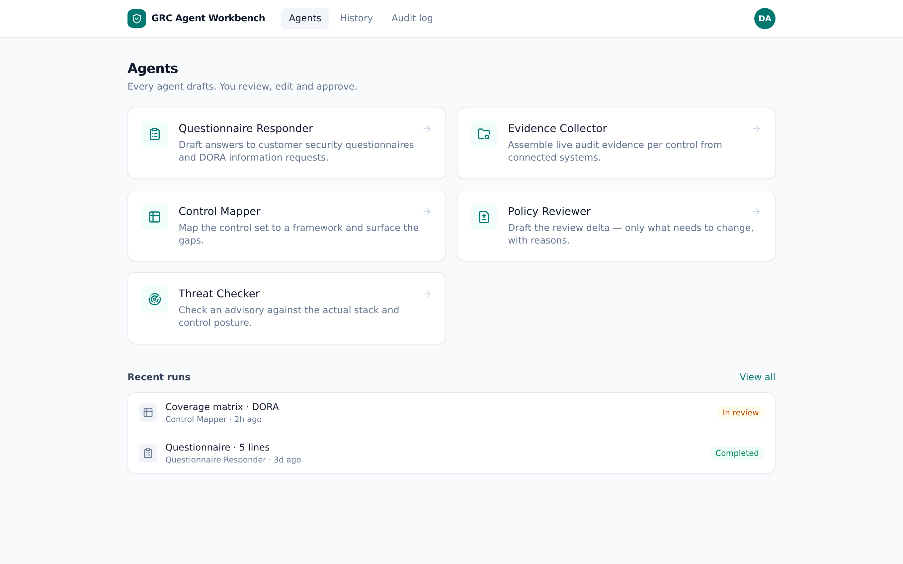
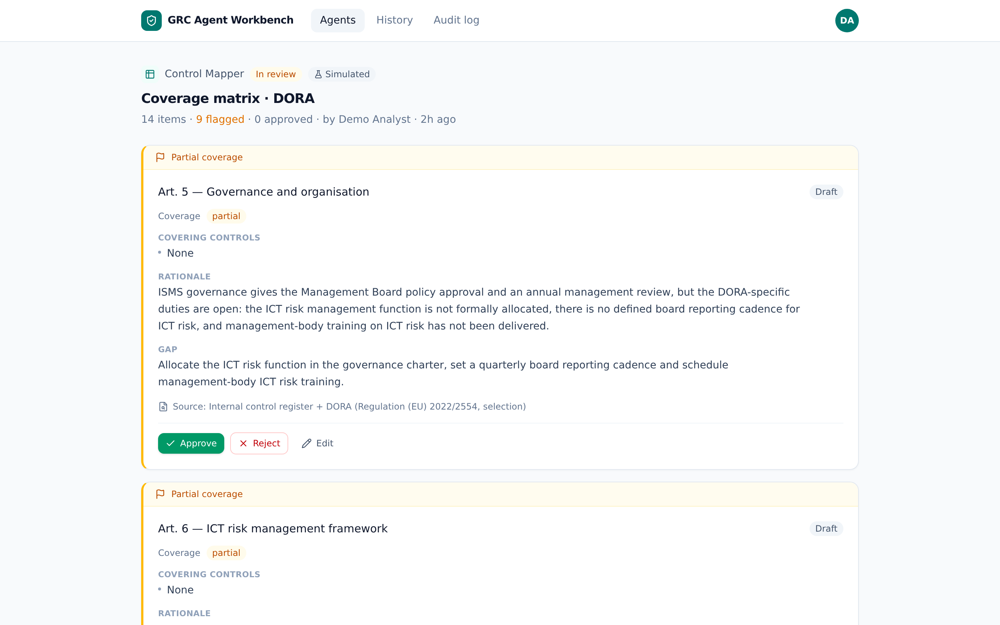

# GRC Agent Workbench

A proof-of-concept workbench where GRC analysts work with five AI agents that **draft** compliance work products — questionnaire answers, audit evidence packs, framework coverage mappings, policy review deltas and threat-exposure assessments — and the analyst **reviews, edits, approves or rejects** every item. Nothing is final until a human decides, every drafted item carries a source note and a confidence flag, and every action lands in an audit log.

**Runs out of the box with no API key.** Without `ANTHROPIC_API_KEY`, drafting is served by a built-in simulated engine that reads the same seeded organisation knowledge base the live prompts use — rich, input-aware output, identical shapes, marked with a subtle "Simulated" badge. Add a key later and the same flows are served by Claude, with no other change.

> All organisation data is fictional ("Aldervelt Financial Group", an ISO 27001-certified Benelux asset manager in scope of DORA and NIS2) — the app demos fully without any real client data.





## The five agents

| Agent | Input | Output |
| --- | --- | --- |
| **Questionnaire Responder** | Pasted questionnaire | One drafted answer per question with source note; unanswerable questions flagged "unsure", never guessed |
| **Evidence Collector** | Control IDs/names | Evidence pack per control from connected-system snapshots — timestamped items, what-counts notes; missing/stale/partial flagged |
| **Control Mapper** | Framework (ISO 27001 / DORA / NIS2) | One mapping row per requirement: covering controls, full/partial/none, rationale; gaps flagged |
| **Policy Reviewer** | Policy text + change note | Only the delta: current vs proposed text per change, with reasons; uncertain changes flagged |
| **Threat Checker** | Pasted advisory | Exposure conclusion (exposed / not exposed / explicitly undetermined) vs the asset register + prioritised draft actions |

Every agent follows the same loop the UI makes visible: **Input → Agent drafts → Analyst reviews → Approve / edit / reject → Output filed** (copy or download as Markdown/JSON, approved items only).

The coverage scenario tells one coherent story across agents: the ISO 27001 view is mostly green with surveillance-audit-style findings (incomplete asset ownership, awareness completion below target, a descoped DR test), while the substantive gaps sit in the DORA/NIS2-specific obligations an ISO ISMS doesn't give you for free — incident-reporting clocks, the register of information, TLPT, contract remediation, effectiveness assessment.

## Quickstart (local, no API key)

Requires **Node 22** (`better-sqlite3`'s native module crashes on Node 24 — `engines` pins `22.x`).

```bash
npm install
cp .env.example .env.local        # then set AUTH_SECRET:
npx auth secret                    # or: openssl rand -base64 32
npm run dev
```

Open http://localhost:3000 → **Continue as demo analyst**. The database self-seeds on first request (org knowledge base + two demo runs so History and the Audit log look alive). Each agent's form has a **Use sample input** link for a one-click demo.

## Environment variables

| Variable | Required | Purpose |
| --- | --- | --- |
| `AUTH_SECRET` | ✅ | Session signing secret (`npx auth secret`) |
| `AUTH_URL` | prod | Public URL of the deployment, e.g. `https://grcai.example.com` |
| `DEMO_LOGIN` | — | `true` forces the demo login; it is also auto-enabled whenever Entra isn't configured |
| `AUTH_MICROSOFT_ENTRA_ID_ID` / `_SECRET` / `_ISSUER` | — | Microsoft SSO. Issuer: `https://login.microsoftonline.com/<TENANT_ID>/v2.0` |
| `ANTHROPIC_API_KEY` | — | Unset ⇒ simulated drafting engine. Set ⇒ live Claude API |
| `ANTHROPIC_MODEL` | — | Default `claude-opus-5` |
| `ANTHROPIC_MAX_TOKENS` | — | Default `32000` |
| `DATABASE_PATH` | — | SQLite file, default `./data/grcai.db` (Railway: `/data/grcai.db`) |

`GET /api/health` needs no session and reports `{status, database, runs, engine}` — use it as the platform healthcheck and as the first stop when a deployment misbehaves.

## Deploy on Railway

1. Create a Railway service from this repo. Next.js is auto-detected (`npm run build` / `npm run start`, the injected `PORT` is honored) and the Node version comes from `engines` (**22.x** — do not override it to 24, see Troubleshooting).
2. Attach a **volume** mounted at `/data`, and set `DATABASE_PATH=/data/grcai.db` — run history and the audit log survive restarts and redeploys.
3. Set `AUTH_SECRET`, `AUTH_URL=https://<your-domain>`, and `DEMO_LOGIN=true` for demo mode.
4. Set the service healthcheck path to `/api/health` so only deployments with a working database go live.
5. Optional — Microsoft SSO: create an Entra ID app registration (web platform) with redirect URI `https://<your-domain>/api/auth/callback/microsoft-entra-id`, then set the three `AUTH_MICROSOFT_ENTRA_ID_*` variables.
6. Optional — live Claude: set `ANTHROPIC_API_KEY`. Nothing else changes.

A custom domain works as-is, including proxied through Cloudflare — set `AUTH_URL` to the public domain. Sign-in and redirects are deliberately built on relative navigation, so they survive reverse proxies that rewrite the `Host` header.

## Suggested demo script

1. Sign in as demo analyst → agent gallery. History already shows a completed questionnaire run and a **DORA coverage mapping in review** (14 requirements, 9 flagged — the "ISO-certified but DORA remediation in flight" story: reporting clocks not drilled, register of information still manual, TLPT applicability open, legacy contracts missing mandated clauses).
2. **Questionnaire Responder** → sample input → 6 drafted answers, one flagged "unsure" (cyber insurance). Edit one answer, approve it (badge shows *approved · edited*), reject the flagged one, **Approve unflagged**, then copy/download the export.
3. **Evidence Collector** → sample input → one complete pack, one **stale** (DR test evidence ~200 days old), one **missing** (no connected system).
4. **Control Mapper** → NIS2 → 10 measures with one hard gap (no effectiveness-assessment procedure, Art. 21(2)(f)) and partials that echo other agents' findings (asset ownership, awareness completion, missing CVD channel).
5. **Policy Reviewer** → sample input → two confident diffs (passkeys, automated offboarding) and one flagged uncertain addition (DORA clause).
6. **Threat Checker** → sample advisory → **exposed** via PostgreSQL with a prioritised action plan; paste a GitLab advisory instead → **not exposed**.
7. **Audit log** → every step above, attributed and timestamped.

## Architecture (10 lines)

- **Next.js 15** (App Router) + TypeScript + Tailwind v4; one app serving UI + API route handlers.
- **SQLite** (`better-sqlite3`) with a lazy singleton that creates the schema and seeds on first runtime touch — build never touches the DB. Journal mode is deliberately `DELETE`, not WAL: WAL's shared-memory mmap can fault natively on mounted volume filesystems, and single-analyst traffic doesn't need it.
- **Auth.js v5**: Microsoft Entra ID + env-gated demo credentials provider; JWT sessions. Sign-in/out run over the REST flow with relative client-side navigation, and the middleware bounces unauthenticated page loads via a relative redirect — no absolute URLs that could leak an internal host behind a misconfigured proxy.
- **Agent registry** (`lib/agents/*`): each agent = input form spec + Zod output schema + prompt builder + item renderer + flag logic + export formatter.
- **Drafting** (`lib/drafter.ts`): routes to the **simulated engine** (`lib/mock/*`, input-aware generators over the seeded org knowledge) or **Claude** (`lib/claude.ts`, streaming + structured outputs via `zodOutputFormat`, server-side refusal fallbacks enabled).
- Runs process asynchronously in-process (Railway = persistent server); the review screen polls until drafts land.
- Items are immutable-original + editable-current, so "approved · edited" is always reconstructable; all actions write to `audit_log`.
- Seeded knowledge base: fictional org profile, 16 controls, policies, past Q&A, asset register, and timestamped connected-system snapshots (freshness computed at seed time so stale findings stay realistic).
- Framework catalogs (`lib/frameworks.ts`): condensed ISO 27001:2022 / DORA / NIS2 requirement sets with stable IDs, injected into prompts and shared with the simulated mapper so rows are deterministic.

## Checks

```bash
npm run smoke    # schemas, DB seed, simulated generators vs schemas (add --live for one real API call)
npm run build    # production build
npm run lint
```

## Troubleshooting

- **Process dies with `Segmentation fault` at the first page after sign-in** — you are on Node 24; `better-sqlite3`'s native binding crashes there. Use Node 22 (`engines` pins it; on Railway also check the build log's selected Node version).
- **`GET /api/health`** tells the layers apart: `200 {"status":"ok",...}` means app + database are fine; `500` names the database error; no response means the process itself is down — read the deploy logs.
- On first database touch the server logs `[db] opened <path> (journal="delete")` — if that line is missing, no request has reached the database layer yet.
